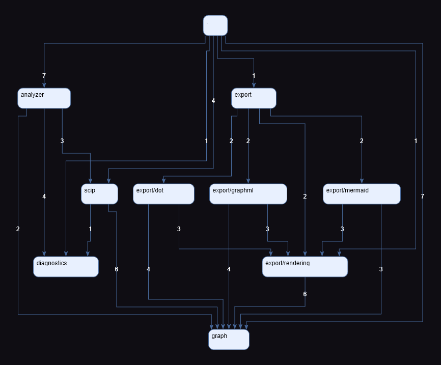

# source-mesh

[](https://crates.io/crates/source-mesh)


[](https://generalgda.github.io/source-mesh/)

Dependency graphs, cycle reports, and outgoing dependency limits for Rust projects.
Exports **GraphML**, **Mermaid**, and **DOT**.

## Example

Folder dependencies in this repository's `crates/source-mesh-core/src`, with test-only dependencies excluded and no folder grouping.
The `.` node represents files directly in `src`.



To recreate the diagram above, export the graph as GraphML from the root of this repository:

```console
source-mesh . --no-settings --root crates/source-mesh-core/src --format graphml --exclude-tests --output source-mesh-core.graphml
```

Then open `source-mesh-core.graphml` in [yEd](https://www.yworks.com/products/yed).

## Install

From the project you want to analyze, install the analysis components and the latest release:

```console
rustup component add rust-analyzer rust-src
cargo install source-mesh --locked
```

## Run

From the Rust project you want to analyze:

```console
source-mesh . --root src --format graphml --exclude-tests --output folders.graphml
```

View the output with a tool for its format:

- **DOT**: [Graphviz](https://graphviz.org/).
- **GraphML**: [yEd](https://www.yworks.com/products/yed).
- **Mermaid**: [Mermaid Live Editor](https://mermaid.live/).

Arrows show dependency direction: `A → B` means code in folder A uses code from folder B. Edge labels count distinct file pairs. Folder aggregation can introduce cycles even when the file graph is acyclic.

Analysis of large projects can take several minutes. Use `--verbose` for diagnostic details and `source-mesh --help` for all options.

To find and highlight cycles:

```console
source-mesh . --root src --format graphml --exclude-tests --highlight-cycles --cycles-output folder-cycles.md --file-cycles-output file-cycles.md --output folders.graphml
```

### Available options

| Option | Effect |
|---|---|
| `--depth 1` | Only folders immediately below `--root` (default: all depths) |
| `--group-folders` | Show subfolders inside their parent groups |
| `--format dot` / `--format mermaid` | Export another diagram format |
| `--exclude-tests` | Omit dependencies found only with test configuration enabled |
| `--exclude 'src/generated/**'` | Remove matching files and their incoming/outgoing dependencies; repeat for multiple patterns |
| `--settings FILE` | Load an explicit TOML configuration instead of the project's `source-mesh.toml` |
| `--no-settings` | Disable TOML configuration loading |
| `--highlight-cycles` | Give each connected group of cycles a distinct color |
| `--fail-on-cycles` | Exit unsuccessfully when file or folder cycle groups are found, after writing requested outputs |
| `--cycles-output FILE` | Write folder cycle chains to Markdown |
| `--file-cycles-output FILE` | Write file cycle chains before folder aggregation |
| `--max-outgoing-dependencies N` | Fail when a file or folder has more than N distinct outgoing targets |
| `--outgoing-dependencies-mode files\|folders` | Select the threshold check's scope (default: `folders`) |
| `--outgoing-dependencies-output FILE` | Write outgoing dependency violations to Markdown; requires a threshold |
| `--verbose` / `-v` | Include diagnostic details and timings |

## Configuration file

`source-mesh.toml` is loaded automatically from the selected project directory (current directory by default).
Use `--settings FILE` to choose another file or `--no-settings` to skip it. All settings are optional:

```toml
[graph]
root = "."
depth = 3
include-self = false
exclude-tests = true
exclude = ["crates/*/src/generated/**", "**/fixtures/**", "crates/server/src/compat.rs"]

[export]
format = "graphml"
output = "folders.graphml"
group-folders = true

[cycles]
highlight-cycles = true
fail-on-cycles = true
cycles-output = "folder-cycles.md"
file-cycles-output = "file-cycles.md"
cycle-limit = 10000

[outgoing-dependencies]
maximum = 10
mode = "folders"
output = "dependencies.md"

[analysis]
verbose = false
```

- **Priority:** explicit CLI values > TOML values > built-in defaults. Use `--flag=false` to disable a configured flag.
- **Paths:** file paths in TOML are relative to its directory; CLI file paths are relative to the working directory.
  `root` remains project-relative.
- **Exclusions:** CLI `--exclude` values replace the TOML list, rather than append to it.

`[analysis]` also accepts `from-scip`, `save-scip`, and `config` (the rust-analyzer JSON configuration).

### Excluding files and folders

`--exclude` / `[graph].exclude` remove matching files and their dependencies from diagrams and all checks, not from indexing.

Patterns are case-sensitive and project-relative (not relative to `--root`), with `/` separators.
Use `src/generated/**` for a directory tree or `**/fixtures/**` for fixture directories at any depth. `.gitignore` is not used.

## Outgoing dependency limits

Limit each folder to at most five distinct dependency targets:

```console
source-mesh . --root src --exclude-tests --max-outgoing-dependencies 5 --outgoing-dependencies-output dependencies.md --output folders.dot
```

Use `--outgoing-dependencies-mode files` to check files instead of folders. A limit of `0` forbids outgoing dependencies.
Both modes respect `--root`, `--exclude-tests`, and `--exclude`.

On a violation, source-mesh writes the diagram and requested reports, lists violations in stderr, and exits with code `1`.

## GitHub Actions

`--fail-on-cycles` makes cycle detection fail the CI step after writing the requested outputs.
The workflow below publishes reports in the run summary and uploads diagnostics when the cycle check fails.

Copy [the summary helper](https://github.com/GeneralGDA/source-mesh/blob/main/scripts/Publish-CycleSummary.ps1)
to `scripts/Publish-CycleSummary.ps1` in your repository.

```yaml
jobs:
  dependency-cycles:
    runs-on: ubuntu-latest

    steps:
      - uses: actions/checkout@v7.0.1
        with:
          persist-credentials: false

      - run: rustup component add rust-analyzer rust-src

      - name: Install source-mesh
        run: cargo install source-mesh --locked

      - name: Check dependency cycles
        id: dependency_cycles
        run: |
          mkdir -p target/source-mesh
          source-mesh . \
            --root src --format graphml --exclude-tests \
            --highlight-cycles --fail-on-cycles \
            --cycles-output target/source-mesh/folder-cycles.md \
            --file-cycles-output target/source-mesh/file-cycles.md \
            --output target/source-mesh/folder-dependencies.graphml

      - name: Publish cycle summary
        if: >-
          ${{ always() && (steps.dependency_cycles.outcome == 'success' || steps.dependency_cycles.outcome == 'failure') }}
        shell: pwsh
        run: >-
          ./scripts/Publish-CycleSummary.ps1 -SummaryPath $env:GITHUB_STEP_SUMMARY
          -ReportPaths target/source-mesh/folder-cycles.md,target/source-mesh/file-cycles.md

      - name: Upload cycle diagnostics
        if: ${{ always() && steps.dependency_cycles.outcome == 'failure' }}
        uses: actions/upload-artifact@v7.0.1
        with:
          name: source-mesh-cycle-diagnostics
          path: target/source-mesh
          if-no-files-found: warn
```

## Reusing analysis

Save analysis with `--save-scip analysis.scip`; reuse it with `--from-scip analysis.scip` to change formats, depth, or filters without analyzing the source again.

## Further reading

- [Changelog](https://github.com/GeneralGDA/source-mesh/blob/main/CHANGELOG.md)
- [Development guide](https://github.com/GeneralGDA/source-mesh/blob/main/DEVELOPMENT.md)

## License

[MIT](LICENSE)
